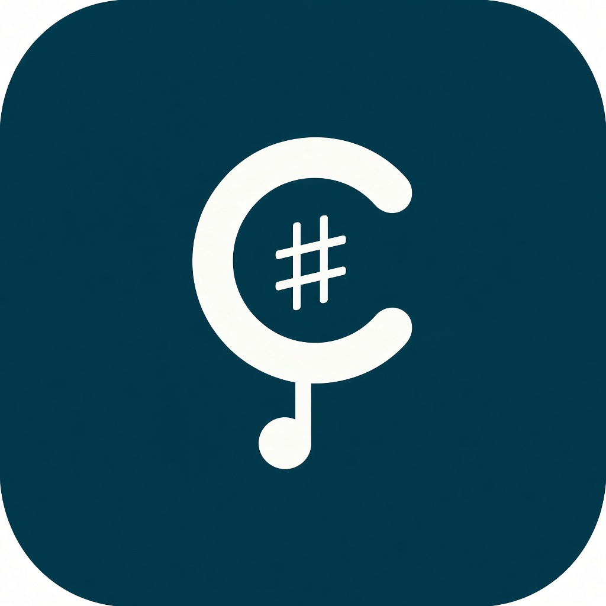

  

<h1 align="center">Cantaria</h1>

  ChordPro- und PDF-Lieder · Song Sets · Teams 
  Daten liegen im Google-Drive-Ordner eures Teams.

  <a href="https://app-cantaria.web.app"><strong>Im Browser öffnen</strong></a>
  ·
  <a href="https://github.com/BuggyFreak/Cantaria/releases/latest"><strong>Android-APK herunterladen</strong></a>

---

## Was Cantaria kann

- **Lieder** — ChordPro und PDF aus dem Team-Ordner anzeigen, durchsuchen und bearbeiten
- **Song Sets** — Sets zusammenstellen, live mit dem Team teilen
- **Teams** — gemeinsamer Drive-Ordner, Einladungen, aktives Team wählen
- **Web & Android** — gleiche Anmeldung über Google

## Android installieren

1. Unter [Releases](https://github.com/BuggyFreak/Cantaria/releases/latest) die neueste `Cantaria-…apk` laden  
2. Die Datei auf dem Handy öffnen und die Installation bestätigen  
3. Falls Android blockt: bei der Quelle die Installation unbekannter Apps erlauben  

Aktuell: **Cantaria 1.3.1 (Build 17)**

## Web

Die Web-App läuft unter [app-cantaria.web.app](https://app-cantaria.web.app).

## Hinweise

Dieses Repository veröffentlicht nur die Android-APK und diese Seite. Der Quellcode liegt privat.

Anmeldung mit Google; Lieder und Sets gehören zum Drive-Ordner des aktiven Teams.
